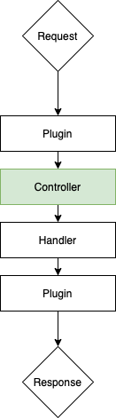

# Controllers

A controller is an Erlang module with functions that the router calls for a
request. Controllers live in `src/controllers/` of a Nova application. A
controller function takes the request and returns a tuple that says what to
answer.



```erlang
-module(my_app_items_controller).
-export([index/1, show/1, create/1]).

index(_Req) ->
    {json, #{items => []}}.

show(#{bindings := #{~"id" := Id}}) ->
    {json, #{id => Id}}.

create(#{json := Item}) ->
    {json, #{created => Item}}.
```

The request is the Cowboy request map with the keys Nova adds to it, see
[the request map](request-lifecycle.md#the-request-map). Use the `cowboy_req`
functions to read headers, the query string and cookies.

## Return values

The first element of the returned tuple names a *handler*, the function that
turns the tuple into a response. The handlers below come with Nova. You can
add your own, see [Handlers](handlers.md).

Every form has a variant with the request as the last element. Use it when
the controller changed the request, for instance to set a cookie or a
response header:

```erlang
remember(Req) ->
    Req1 = cowboy_req:set_resp_cookie(~"seen", ~"1", Req, #{path => ~"/"}),
    {json, 200, #{}, #{ok => true}, Req1}.
```

Set cookies with `cowboy_req:set_resp_cookie/4`. A `set-cookie` key in a
headers map is refused by Cowboy and the response becomes a `500`.

### JSON

| Return | Response |
|---|---|
| `{json, JSON}` | `201` when the request method is `POST`, `200` otherwise |
| `{json, StatusCode, Headers, JSON}` | The given status code and headers |
| `{json, StatusCode, Headers, JSON, Req}` | As above, with the request handed back |

```erlang
{json, #{status => ~"ok"}}
{json, 202, #{~"x-request-id" => ~"abc"}, #{queued => true}}
```

`JSON` is a term the configured JSON library can encode, see `json_lib` in
[Configuration](configuration.md). The `content-type` is `application/json`.

The older order `{json, StatusCode, Headers, Req, JSON}` is still accepted. It
is deprecated and logs a warning once per controller module.

### Views

Renders an ErlyDTL template, see [Views](views.md). `ok` and `view` mean the
same.

| Return | Response |
|---|---|
| `{ok, Variables}`, `{view, Variables}` | The view named after the controller, with status `200` |
| `{ok, Variables, Options}`, `{view, Variables, Options}` | As above, with options |
| `{ok, Variables, Options, Req}`, `{view, Variables, Options, Req}` | As above, with the request handed back |

```erlang
{ok, #{name => ~"Alice"}}
{view, #{name => ~"Alice"}, #{view => profile, status_code => 201}}
```

`Variables` is a map or a property list. For a controller named
`my_app_main_controller` the default view is `src/views/my_app_main.dtl`.

| Option | Description |
|---|---|
| `view` | The template to render, as an atom or a string |
| `status_code` | The status code, `200` by default |
| `headers` | The response headers. They replace the default `content-type: text/html`, so include a `content-type` |

A template that does not exist gives a `404`.

### Status codes

| Return | Response |
|---|---|
| `{status, StatusCode}` | The status code with an empty body |
| `{status, StatusCode, Headers}` | With headers |
| `{status, StatusCode, Headers, Body}` | With headers and a body |
| `{status, StatusCode, Headers, Body, Req}` | As above, with the request handed back |

```erlang
{status, 204}
{status, 201, #{~"location" => ~"/api/items/1"}}
{status, 400, #{~"content-type" => ~"text/plain"}, ~"bad input"}
{status, 422, #{}, #{error => ~"invalid"}}
```

`Body` is a binary, or a map, which is encoded as JSON and sent with
`content-type: application/json`.

`{status, StatusCode}` does not render the status code route registered for
that code (see [Routing](routing.md)). A `204` and a `304` have no body: one
given with either status, by this or any other handler, is left out.

### Redirects

| Return | Response |
|---|---|
| `{redirect, Location}` | `302` with `Location` in the `location` header |
| `{redirect, Location, Req}` | As above, with the request handed back |
| `{redirect_local, Path}` | `302`, but only to a path on the same site |
| `{redirect_local, Path, Req}` | As above, with the request handed back |

```erlang
{redirect, "/login"}
```

`Location` is a string or a binary. `redirect` accepts any URL, another site
included, so do not pass it something the request supplied.

Use `redirect_local` for a target that comes from the request, such as the
`next` parameter of a login form:

```erlang
login_done(Req) ->
    #{next := Next} = cowboy_req:match_qs([{next, [], ~"/"}], Req),
    {redirect_local, Next}.
```

The target has to start with a single `/`. A full URL, `//host`, `/\host` and
a path with a tab in it are answered with a `400` and logged as a warning.

### Files

| Return | Response |
|---|---|
| `{sendfile, StatusCode, Headers, {Offset, Length, Path}, Mime}` | `Length` bytes of the file at `Path`, starting at `Offset` |
| `{sendfile, StatusCode, Headers, {Offset, Length, Path}, Mime, Req}` | As above, with the request handed back |

```erlang
download(_Req) ->
    Path = filename:join(code:priv_dir(my_app), "static/hello.txt"),
    {sendfile, 200, #{}, {0, filelib:file_size(Path), Path}, ~"text/plain"}.
```

The file is sent with Cowboy's sendfile support, see
[Sending files](https://ninenines.eu/docs/en/cowboy/2.21/guide/resp/) in the
Cowboy guide. To serve a directory of files, use a static route instead, see
[Routing](routing.md).

Incoming files are handled by `nova_multipart_plugin` and not by a return
value. See [Nova multipart](plugins.md#nova-multipart).

## Errors

A controller can stop with a status code by throwing `{StatusCode, Reason}`:

```erlang
show(#{bindings := #{~"id" := Id}}) ->
    case my_app_items:find(Id) of
        {ok, Item} -> {json, Item};
        not_found -> throw({404, no_such_item})
    end.
```

The response is the status page for that code. Any other exception is logged
as `Controller crashed` and answered with the `500` page. A return value no
handler knows is answered with a `500` as well, unless the controller has a
fallback controller. See [Error handling](error-handling.md).

## Fallback controllers

When a controller returns something no handler knows, Nova calls the fallback
controller of the module if it has one. This separates error handling from
the controllers. The fallback controller is named with the
`fallback_controller` attribute:

```erlang
-module(my_app_main_controller).
-export([error_example/1]).
-fallback_controller(my_app_fallback_controller).

error_example(_Req) ->
    %% {error, ...} is not a handler, so the fallback controller is called
    {error, example_error}.
```

A fallback controller exports `resolve/2`. It takes the request and the value
the controller returned, and returns what a controller can return:

```erlang
-module(my_app_fallback_controller).
-export([resolve/2]).

resolve(_Req, {error, example_error}) ->
    {status, 400, #{~"content-type" => ~"text/plain"}, ~"example_error"}.
```

## Plugins

Plugins run before and after a controller. They are configured globally in
*sys.config* or for a route group in the router, as a list of
`{Phase, Module, Options}`:

```erlang
{nova, [
    {plugins, [
        {pre_request, nova_request_plugin, #{decode_json_body => true}}
    ]}
]}
```

```erlang
routes(_Environment) ->
    [#{prefix => "/api",
       security => false,
       plugins => [
           {pre_request, nova_request_plugin, #{decode_json_body => true}}
       ],
       routes => [
           {"/items", fun my_app_items_controller:create/1, #{methods => [post]}}
       ]}].
```

A route group that declares `plugins` uses those and not the global ones. The
[Plugins](plugins.md) guide lists the plugins that come with Nova and their
options, and shows how to write one.

> #### Applications meant to be included {: .tip}
>
> An application that other Nova applications include should declare its
> plugins in its router. The global plugins belong to the release it ends up
> in.

## Websockets

A websocket endpoint is a module with the `nova_websocket` behaviour, not a
controller function. See [Websockets](websockets.md).
