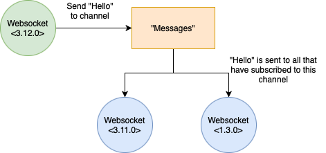

# Nova Pubsub

`nova_pubsub` is a small publish and subscribe mechanism for sending messages
between processes, on one node or across a cluster. It is built on OTP's `pg`
module, which provides distributed named process groups. It is meant as a
simple message bus: messages are not stored and delivery is not confirmed. If
you need more, look at a message broker such as
[RabbitMQ](https://www.rabbitmq.com/) or a protocol such as
[MQTT](https://mqtt.org).

## Basic concepts

A process joins a *channel*. A message broadcast to that channel is sent to
every process that joined it. A message carries a *topic*, which the
receivers use to tell the messages of one channel apart.



*Two processes have joined the channel "Messages". When a third process
broadcasts "Hello" on it, both receive the message.*

| Function | Description |
|---|---|
| `nova_pubsub:join/1,2` | Add the calling process, or the given one, to a channel |
| `nova_pubsub:leave/1,2` | Remove it. Returns `not_joined` when it was not a member |
| `nova_pubsub:broadcast/3` | Send a message with a topic to every member of a channel, on every node |
| `nova_pubsub:local_broadcast/3` | As `broadcast/3`, to the members on this node only |
| `nova_pubsub:get_members/1`, `nova_pubsub:get_local_members/1` | The members of a channel |

A channel is an atom or a binary. A topic is a string or a binary.

A member receives the message as a `#nova_pubsub{}` record, defined in
`nova_pubsub.hrl`, with the fields `channel`, `sender`, `topic` and
`payload`.

## Example

```erlang
-module(my_app_pong).
-export([player/3]).

-include_lib("nova/include/nova_pubsub.hrl").
-include_lib("kernel/include/logger.hrl").

player(Name, Expected, Smash) ->
    spawn(fun() ->
                  ok = nova_pubsub:join(game_of_pong),
                  game_loop(Name, Expected, Smash)
          end).

game_loop(Name, Expected, Smash) ->
    receive
        #nova_pubsub{topic = "match1", payload = Expected} ->
            ?LOG_INFO(#{player => Name, received => Expected, returning => Smash}),
            nova_pubsub:broadcast(game_of_pong, "match1", Smash),
            game_loop(Name, Expected, Smash);
        _ ->
            game_loop(Name, Expected, Smash)
    end.
```

Two players that answer each other, and the serve that starts the game:

```erlang
my_app_pong:player(~"one", ~"ping", ~"pong"),
my_app_pong:player(~"two", ~"pong", ~"ping"),
nova_pubsub:broadcast(game_of_pong, "match1", ~"ping").
```

A websocket controller receives the record in `websocket_info/2`, see
[Websockets](websockets.md#pubsub).

## Configuration

Pubsub is started with Nova and has no settings. To reach processes on other
nodes the nodes have to be connected with distributed Erlang.

## When the scope is restarted

The subscriptions are kept by a `pg` scope, a process registered as `nova_scope` that Nova supervises. If it dies it is started again, empty: every process on the node has left every channel and receives nothing until it calls `nova_pubsub:join/1,2` again. Processes on other nodes stay subscribed.

A process that has to stay subscribed monitors the scope with `monitor(process, nova_scope)` and joins again once the scope is back. `nova_pubsub:join/1,2` fails with `noproc` until then.
